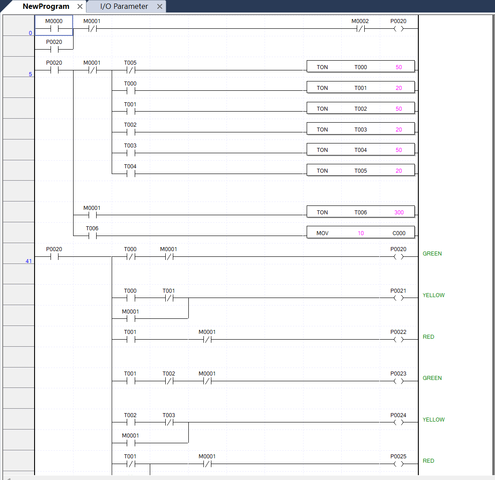
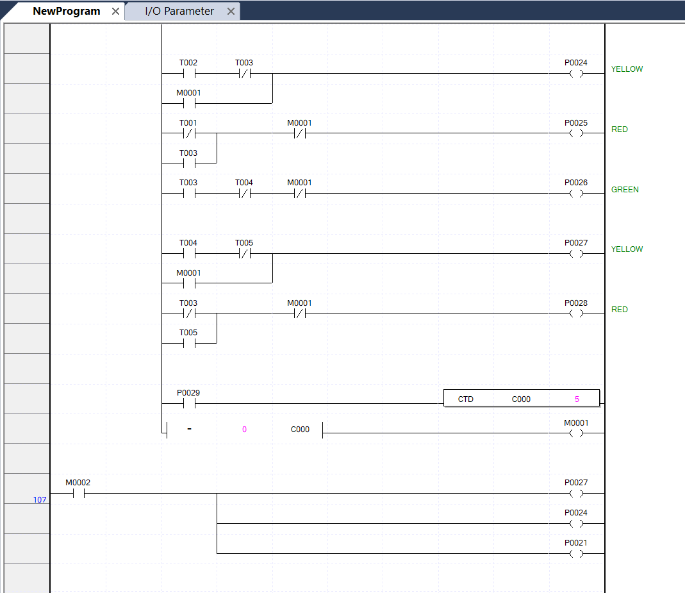

# PLC Traffic Light with HMI

A 3-way junction traffic light controlled by ladder logic on an LS PLC, with an HMI for monitoring. Built as a midterm project and tested on a PLC trainer module.

## Overview

| | |
|---|---|
| **Controller** | LS PLC |
| **Programming** | XG5000 (ladder logic) |
| **HMI** | XP-Builder |
| **I/O** | 2 control inputs, 9 light outputs |
| **Tested on** | PLC trainer module |

## Signals

| Signal | Green | Yellow | Red |
|---|---|---|---|
| Head 1 | P0020 | P0021 | P0022 |
| Head 2 | P0023 | P0024 | P0025 |
| Head 3 | P0026 | P0027 | P0028 |

| Input | Function |
|---|---|
| M0000 | Start |
| M0002 | Stop, with all yellow lights on |
| P0029 | Count input for the down counter C000 |

## Ladder logic

Six on-delay timers run in a chain and repeat, so each head gets its green and yellow turn while the others stay red.

| Timer | Stage | Preset |
|---|---|---|
| T000 | Head 1 green | 50 |
| T001 | Head 1 yellow | 20 |
| T002 | Head 2 green | 50 |
| T003 | Head 2 yellow | 20 |
| T004 | Head 3 green | 50 |
| T005 | Head 3 yellow | 20 |

When C000 counts down to 0, M0001 switches the junction to all yellow. Timer T006 (preset 300) then reloads C000 and returns to the normal sequence.

The HMI shows the junction map, the signal lamps and a start button.

## Hardware test

## Repository contents

| Path | Contents |
|---|---|
| `plc/` | XG5000 project files |
| `hmi/` | XP-Builder project file |
| `images/` | HMI, ladder and trainer images |

Opening the project files requires XG5000 and XP-Builder.
