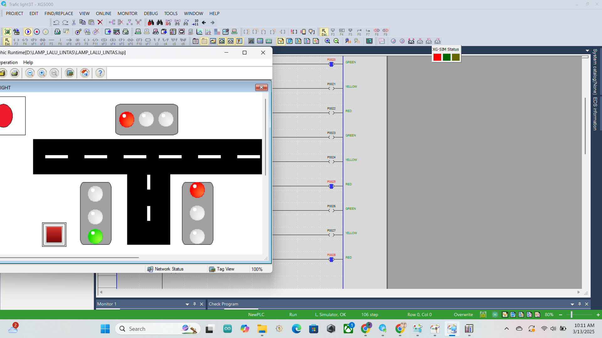
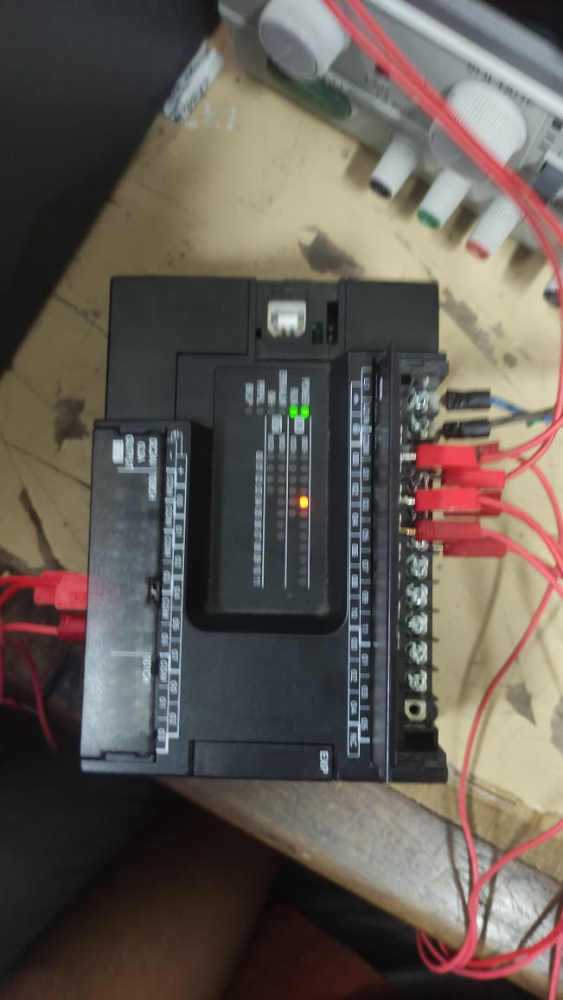

# PLC Traffic Light with HMI

A 3-way junction traffic light controlled by ladder logic on an LS PLC, with an HMI for monitoring. Built as a midterm project and tested on a PLC trainer module.

## Overview

| | |
|---|---|
| **Controller** | LS PLC |
| **Programming** | XG5000 (ladder logic) |
| **HMI** | XP-Builder |
| **I/O** | 2 inputs, 9 outputs |
| **Tested on** | PLC trainer module |

## Signals

| Type | Signal |
|---|---|
| Input | Start/stop |
| Input | Reset |
| Output | 3 signal heads with red, yellow and green lights |

## Timing

Timing is scaled down for testing on the trainer.

| Light | Time |
|---|---|
| Red | 10 s |
| Yellow | 3 s |
| Green | 5 s |

The HMI shows the junction map, the signal lamps and a start button.

## Hardware test

## Repository contents

| Path | Contents |
|---|---|
| `plc/` | XG5000 project files |
| `hmi/` | XP-Builder project file |
| `images/` | HMI and trainer photos |

Opening the project files requires XG5000 and XP-Builder.
